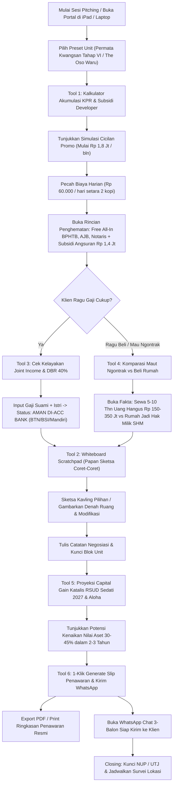

# 🏛️ Alur Interaksi & Arsitektur Tools Pitching Tiar Property (`USER_FLOW_AND_PAGE_ARCHITECTURE.md`)

Dokumen ini memetakan arsitektur informasi, psikologi penutupan penjualan (*closing flow*), dan anatomi 6 fitur utama pada portal **Tools Pitching & Simulasi KPR Tiar Property**.

---

## 🧭 1. Psikologi Alur Pitching (Client Pitching Flow)

---

## 🧰 2. Rincian Anatomi 6 Tools Pitching Tiar Property

### 1. Kalkulator Akumulasi KPR & Subsidi Developer (Hero Pitching Tool)
* **Tujuan:** Menghancurkan *price shock* (rasa kaget harga ratusan juta) dengan membedah skema cicilan ringan dan membuktikan keuntungan promo developer.
* **Fitur Input:**
  * Preset Cepat 1-Klik:
    - `Permata Kwangsan Tahap VI` (Harga Rp 435 Jt, DP 0%, Promo Angsuran Rp 1,8 Jt/bln).
    - `The Oso Waru MERR` (Harga Rp 650 Jt, 2 Lantai, DP 0%, Promo Angsuran Rp 3,8 Jt/bln).
    - `Custom Unit` (Slider fleksibel Rp 250 Jt s/d Rp 1,5 Milyar).
  * Toggle Skema DP: DP 0% (Subsidi Developer) vs DP Mandiri (5%, 10%, 20%).
  * Tenor Slider: 5 s/d 30 Tahun.
  * Suku Bunga Promo: 3.4% - 4.85% (Fixed 1-3 Tahun) -> Floating 8.5% - 10%.
  * **Sakelar Keuntungan Khusus Tiar Property:**
    - Toggle: *Subsidi Angsuran Developer Rp 1.400.000 / bulan (6 - 12 Bulan)*.
    - Toggle: *Free BPHTB (5%), Free AJB, BBN, Biaya Notaris (Hemat Rp 25 - 35 Juta)*.
    - Toggle: *Subsidi Biaya KPR s/d Rp 20 Juta*.
* **Output Visual:**
  - Angka Angsuran Bersih Per Bulan selama promo.
  - **Badge Micro-Installment:** "Setara Rp 60.000 / hari (Cuma 2 cangkir kopi kekinian!)".
  - Tabel Akumulasi Penghematan Konsumen (Total potongan s/d Rp 50+ Juta).

---

### 2. Papan Sketsa Interaktif (Interactive Whiteboard & Annotation Scratchpad)
* **Tujuan:** Memfasilitasi sales saat menjelaskan denah, posisi hadap rumah, arah mata angin, atau coretan hitungan langsung di depan mata klien tanpa kertas tercecer.
* **Fitur Utama:**
  * Responsive Canvas (Hi-DPI Retina ready) dengan sentuhan jari / Apple Pencil / stylus / mouse.
  * Toolset: Pen (halus dengan tekanan), Highlighter (stabilo transparan), Eraser, Clear Canvas, Undo, Redo.
  * Pilihan Warna Elegan: Slate Black, ACC Emerald Green, Alert Coral, Blueprint Navy.
  * **Background Template Bawaan:**
    - Polos Bersih (Kertas Putih Alabaster).
    - Grid Milimeter / Dot Grid (Presisi ukuran).
    - Denah Dasar 1 Lantai & 2 Lantai (Tinggal beri coretan ruang/tambah taman).
    - Masterplan Kavling (Lingkari nomor kavling pilihan prospek).
  * Fitur Export: Simpan gambar PNG atau langsung lampirkan ke slip penawaran.

---

### 3. Cek Kelayakan Joint Income & DBR 40% (Bank Approval Feasibility)
* **Tujuan:** Menjawab keraguan terbesar klien *"Gaji saya cukup gak ya buat disetujui bank?"* dalam waktu kurang dari 60 detik.
* **Fitur Input:**
  * Penghasilan Bersih Pemohon (Suami).
  * Penghasilan Pasangan (Istri) -> Sakelar *Joint Income On/Off*.
  * Total Cicilan Berjalan (Motor, Mobil, Kartu Kredit, Paylater).
* **Output Real-time:**
  * **Speedometer DBR (Debt Burden Ratio):**
    - 🟢 *Hijau (< 35%):* Sangat Sehat, Peluang ACC 5 Bank Rekanan 95%+.
    - 🟡 *Kuning (35% - 40%):* Batas Maksimal Analis, Rekomendasi Joint Income.
    - 🔴 *Merah (> 40%):* Over-leverage, Perlu pelunasan cicilan kecil sebelum BI Checking / SLIK OJK.
  * Simulasi Maksimal Plafon KPR yang aman diajukan.
  * Logo & Syarat 5 Bank Rekanan: BTN, BSI, Mandiri, BRI, BNI.

---

### 4. Komparasi Finansial: Ngontrak vs Beli di Tiar Property (Anti-Price Shock)
* **Tujuan:** Menyadarkan prospek bahwa menunda beli rumah dan tetap ngontrak adalah kerugian finansial nyata.
* **Komparasi 5, 10, & 15 Tahun:**
  * **Ngontrak:** Rp 25 - 35 Juta/tahun -> Uang keluar Rp 150 - 350 Juta **100% Hangus Tanpa Sisa Aset**.
  * **Beli Rumah Tiar Property:** Cicilan mulai Rp 1,8 Jt/bln -> **100% Berubah Jadi Aset SHM Milik Sendiri**.
  * Grafik Batang Visual (Side-by-Side Bar Chart) yang membandingkan Uang Hangus vs Ekuitas Rumah.

---

### 5. Proyeksi Capital Gain & Katalis Surabaya-Sidoarjo
* **Tujuan:** Membuktikan nilai investasi properti bagi calon pembeli yang ingin untung atau memikirkan masa depan keluarga.
* **Katalis Infrastruktur Nyata:**
  * Pembangunan RSUD Sedati 2027 (Hanya 1 km dari Permata Kwangsan, proyeksi lonjakan 30-45%).
  * Flyover Aloha & Akses OERR/MERR (Efisiensi waktu tempuh ke Bandara Juanda & Rungkut Surabaya).
* **Kalkulasi:** Estimasi nilai properti di tahun 2026, 2027, 2028, 2029 + estimasi pasif income sewa tahunan.

---

### 6. Slip Penawaran Digital & 1-Klik WhatsApp Closer
* **Tujuan:** Mencegah prospek lupa detail setelah pertemuan selesai.
* **Fitur:**
  * Rangkuman Otomatis seluruh data yang baru saja disimulasikan: Tipe Unit, Harga, DP, Cicilan Promo, Tenor, Bank Rekanan, dan Kupon/Subsidi.
  * Tombol **"Cetak Slip Simulasi / Simpan PDF"** (tata letak bersih, ada watermark Tiar Property).
  * Tombol **"Kirim Rekap via WhatsApp"**: Menghasilkan pesan WhatsApp 3-balon alami dan langsung membuka aplikasi WhatsApp ke nomor klien.

---

## 🎨 3. Standar Desain UI (Light Theme & Tactile Rounded)
1. **Tema Terang Bersih & Elegan:**
   - Background Utama: `#F8F9FA` (Alabaster Light) — nyaman di mata di segala kondisi cahaya.
   - Kartu & Kontainer: `#FFFFFF` dengan bayangan halus (`shadow-sm` & `border border-slate-200/80`).
   - Teks Utama: `#0F172A` (Slate 900) dengan kontras tinggi.
   - Aksen Utama: Hijau Emerald `#059669` (lambang ACC bank & persetujuan) dan Amber Emas `#D97706` (penanda subsidi promo).
2. **Rounded & Modern Geometry:**
   - Kartu beradius `rounded-2xl` s/d `rounded-3xl`.
   - Tombol berbentuk pill `rounded-full` atau `rounded-xl` dengan efek tekan tactile `active:scale-[0.98]`.
   - Slider interaktif dengan indikator balon nilai dinamis.
3. **Penyajian Data:**
   - Seluruh angka nominal rupiah dan persentase wajib memakai tipografi monospaced tabular (`tabular-nums`) agar tidak bergoyang saat digeser.

---

## 🚀 4. Rekomendasi Tech Stack & Tahapan Eksekusi

### Rekomendasi #1 Co-Founder:
**Next.js 15 App Router (Static Export `output: 'export'`) + Tailwind CSS + Framer Motion + Lucide React**
* **Alasan:**
  1. *Kecepatan Instan (< 0.8s):* Tanpa beban serverless atau cold-start, portal terbuka seketika di iPad/HP sales meski sinyal internet di lokasi perumahan sedang lemah.
  2. *Bebas Biaya Server:* Dapat dihosting di mana saja (Vercel, Cloudflare Pages, atau bahkan offline local) tanpa khawatir tagihan server jebol.
  3. *Animasi Halus:* Framer Motion menjamin transisi antar tools dan perhitungan angka bergerak mulus tanpa kedip.

### Tabel Perbandingan Stack:
| Kriteria | Next.js 15 Static Export (Rekomendasi) | React Vite SPA | Next.js Serverless SSR |
| :--- | :--- | :--- | :--- |
| **Kecepatan Buka di Lokasi Survei** | ⚡ **Maksimal (< 0.8s)** | ⚡ Cepat (< 1.2s) | ⏳ Tergantung sinyal (1.5 - 3s) |
| **Bisa Dibuka Offline / PWA** | ✅ **Sangat Mendukung** | ✅ Mendukung | ❌ Butuh koneksi aktif |
| **Biaya Server / Hosting** | 🟢 **Rp 0 (Free Tier Selamanya)** | 🟢 Rp 0 | 🟡 Potensi biaya invocations |
| **Stabilitas Presentasi Sales** | 🛡️ **100% Anti Crash** | 🛡️ Stabil | ⚠️ Rawan timeout jika sinyal drop |
